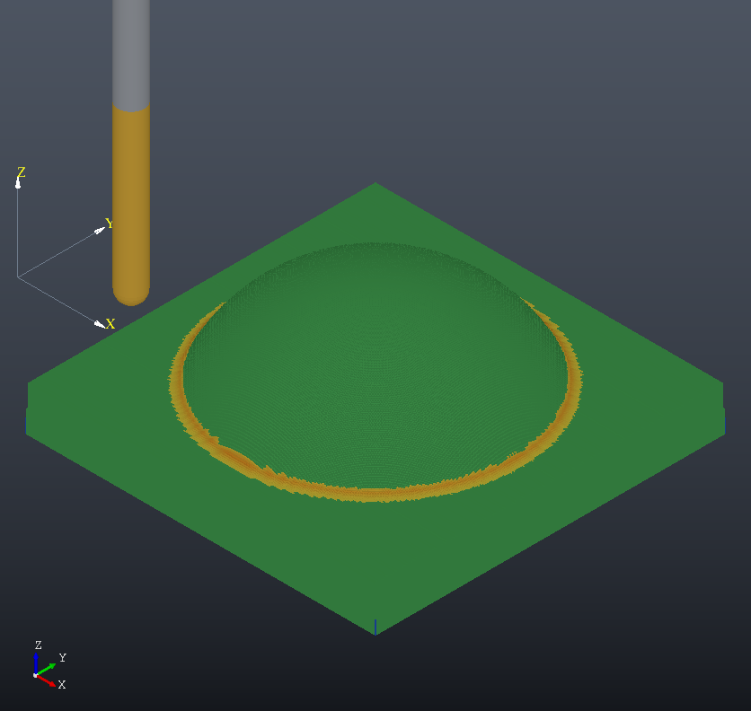
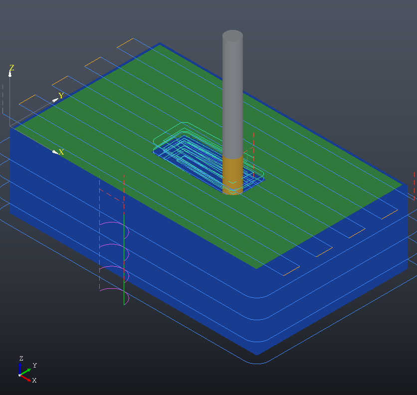
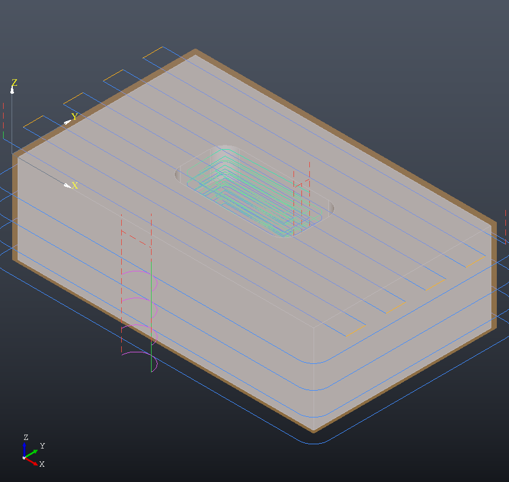
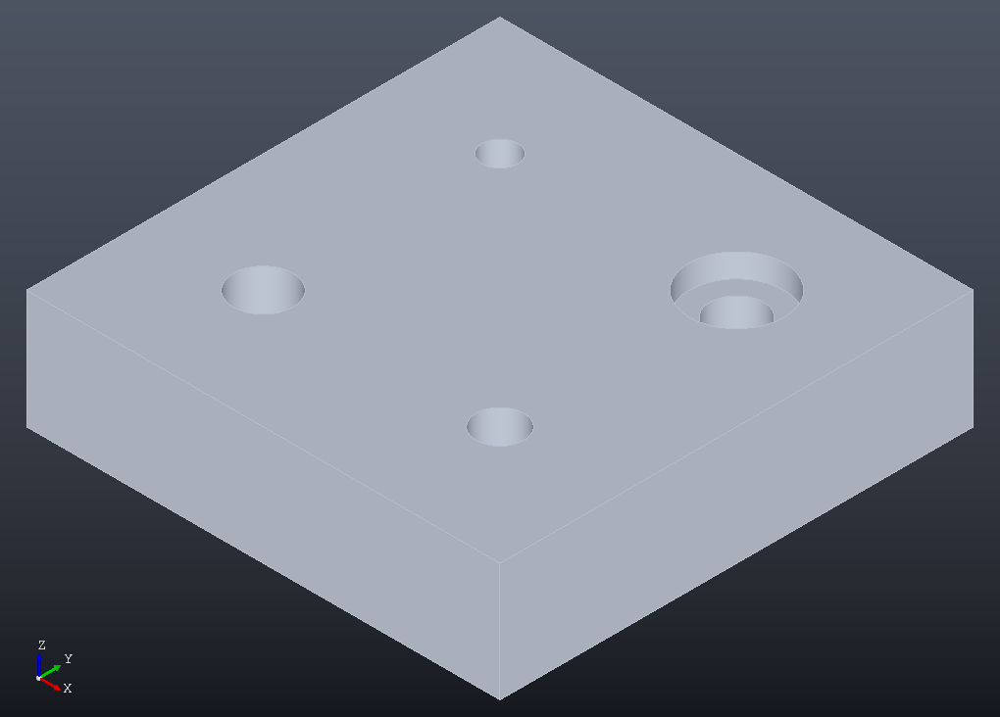

# OxCAM

> OxCAM is short for OxygenCAM; the program was formerly OpenCAM
> ([ADR-0005](docs/adr/0005-oxcam-name.md)). A trademark and name search is required before any
> public launch; see [docs/ip/IP-POLICY.md](docs/ip/IP-POLICY.md).

OxCAM is a clean-room, open-source computer-aided manufacturing (CAM) application.

Goals:

- Import STEP models (via OpenCASCADE).
- User-defined, versioned tool libraries.
- 2.5D and 3D milling, turning, mill-turn and Swiss-type machines.
- Stock and tool simulation with in-process stock, remaining-stock visualization and
  rest machining driven by the simulated stock.
- Machine-independent toolpaths lowered to G-code through post processors written in
  JavaScript and run by an engine built into OxCAM, with generic Fanuc-style posts and a
  classic Haas-style mill post built in. Writing a post for your own machine:
  [docs/posts](docs/posts/README.md).

The first milestone (v0.1) is 2.5D milling end-to-end: STEP import, setup and stock, tool
library, facing / pocket / contour / drill, tri-dexel stock simulation, and a generic
Fanuc-style post processor. See [docs/adr](docs/adr) for architecture decisions.

## Status

**v0.1 (phase 5): 2.5D milling end-to-end.** STEP import, setups and stock, tool libraries,
facing / pocket / contour / drill toolpaths, stock simulation with part comparison, and a
generic Fanuc-style post. **The G-code has not been validated on a physical controller yet.**
Dry-run every program, and help by recording results in
[docs/validation/controller-dry-runs.md](docs/validation/controller-dry-runs.md).

Phase 9 (in development) adds multi-axis milling:

- **4th-axis wrapping:** flat toolpaths wrapped onto a cylinder about the WCS X axis, and a
  **wrapped pocket** operation that clears the recesses of a turned part level by level, each
  level unrolled at its own radius ([DL-0024](docs/design-log/0024-wrapping-and-5axis-finishing.md)).
- **Simultaneous 5-axis ball finishing:** the exact 3-axis ball centres with the tool axis set by
  a user-defined rule: fixed lead/tilt to the surface normal, a fixed direction, or through a
  point, limited by a largest tilt. Points where the tilted flutes or shank would touch the
  part are reported; nothing tilts automatically.
- **Kinematics** of 4-axis (rotary A), table-table, head-table and head-head 5-axis machines:
  closed-form inverse kinematics with continuous rotary axes, and posting with **tool centre
  point control** (G43.4) or **machine positions with inverse-time feeds** (G93), split until the
  machine's interpolation keeps the tip within 0.01 mm. Back-plot verification checks tool axes
  too ([DL-0023](docs/design-log/0023-multi-axis-kinematics-and-posting.md)).
- **5-axis sweeps** in the stock simulation: tilted and turning tools remove material exactly on
  all three dexel grids, with shank, holder and rapid checks
  ([DL-0026](docs/design-log/0026-tilted-tool-sweeps.md)).
- **Machine collision checks:** spindle head, table and trunnion components moved through each
  toolpath by the machine's kinematics, against the part, stock and tool
  ([DL-0025](docs/design-log/0025-machine-collision-checks.md)).
- **Machine models:** a machine's own parts, imported from STEP (kept as exact geometry, meshed
  for the views and checks when loaded) or STL and each carried by the base or an axis of its
  kinematic tree (direction and pivot per axis, the spindle gauge point
  at machine zero). Each setup places its work on the machine by snapping it to the machine's
  faces (a zero-point plate's top, a rotary table's or faceplate's centre on its axis), carried
  by the axis under it. The simulation shows the machine moving with every move (machine fixed,
  or part fixed), with the axis positions, and checks the parts against each other, the part,
  stock, fixtures and tool; solve and the post measure rotary positions from where the work sits
  ([DL-0037](docs/design-log/0037-machine-models.md)).

```bash
oxcam-cli project post build/<preset>/fixtures/rotary_project.ocam -o rotary.nc --verify
oxcam-cli project simulate build/<preset>/fixtures/dome5_project.ocam --resolution 0.5
```

Phase 8 adds turning:

- **Lathe setups** on a built-in generic 2-axis lathe. The part's half profile comes from the
  STEP model sectioned through the spindle axis; the stock is a bar
  ([DL-0020](docs/design-log/0020-turning-strategies.md)).
- **Turning inserts** (ISO shapes, grooving, threading, parting) with outlines for compensation
  and simulation.
- **Operations:**
  - facing;
  - OD/ID roughing with a final profile pass;
  - OD/ID finishing with **nose-radius compensation** (imaginary-tip programming, slope limited
    by the insert's trailing edge);
  - plunge grooving of recesses;
  - multi-pass threading (G32, degressive infeed);
  - parting off;
  - a **bar pull**: a puller on the turret takes the bar out of the open chuck for the next
    part, the stock moving with it; the post writes the chuck's codes and, as an option, loops
    the program for the next part ([DL-0091](docs/design-log/0091-bar-pull.md)).
  - a **transfer to the sub-spindle**: the part handed over and parted off under grip, its back
    turned there, both setups posted as one program
    ([ADR-0007](docs/adr/0007-sub-spindle-transfer.md), [DL-0092](docs/design-log/0092-sub-spindle-transfer.md)).
- **Axisymmetric stock simulation** (2D profile, exact insert sweeps), converted to the
  tri-dexel stock for comparison and later milling
  ([DL-0021](docs/design-log/0021-axisymmetric-stock.md)). It is drawn as the profile revolved
  ([DL-0040](docs/design-log/0040-smooth-stock-display.md)).
- **A lathe's machine in the simulation:** a turret with every tool in its station, riding along and
  checked, a chuck, tailstock, sub-spindle and enclosure, typed in as sizes or imported from STEP. Turret
  and tools move through each toolpath and each index, reported at the operation and move
  ([DL-0067](docs/design-log/0067-lathe-machine-simulation.md)).
- **Tooling blocks and tailstock centres:** a library of STEP models with a turret mount and a tool
  mount, picked or typed. Each turret station chooses a block, the tool mounts through it, and blocks
  and a live centre ride along and are checked
  ([DL-0068](docs/design-log/0068-tooling-blocks-and-centres.md)).
- **Lathe post** (generic Fanuc-style: diameter X, G96/G50 constant surface speed, feed per
  revolution, T0101 tool calls, G32 threads), lathe back-plot verification, and a lathe mode in
  the Python post API ([DL-0022](docs/design-log/0022-lathe-machine-and-post.md)).

```bash
oxcam-cli project post build/<preset>/fixtures/shaft_project.ocam -o shaft.nc --verify
```

Turning since then:

- **Holes on the spindle axis:** drill, tap, ream and bore with a tool standing still, as deep as
  the part lets it or to a set depth, so a part can be bored from solid bar
  ([DL-0043](docs/design-log/0043-lathe-drilling.md)).
- **A second side:** a lathe setup continues the stock an earlier one left, flipped or not, with the
  chuck closing on what is there ([DL-0044](docs/design-log/0044-lathe-stock-from-earlier-setup.md)).
- **Holders checked:** ISO and plain holders against the chuck, the part and the stock, a bar's far
  side across the axis included ([DL-0045](docs/design-log/0045-turning-holder-collisions.md),
  [DL-0053](docs/design-log/0053-plain-turning-holders.md)).
- **Solid tools:** solid carbide micro boring bars, by the dimensions they are sold by
  ([DL-0046](docs/design-log/0046-solid-turning-tools.md)).
- **Threads** inside, left hand, multi-start and tapered
  ([DL-0047](docs/design-log/0047-turning-threads.md)), and **grooves** in a bore and in a face
  ([DL-0048](docs/design-log/0048-inside-and-face-grooves.md)).
- **Roughing and finishing** of a Z range, passes across Z
  ([DL-0049](docs/design-log/0049-turning-z-range-and-facing-passes.md)), and back turning with
  left-hand tools ([DL-0050](docs/design-log/0050-left-hand-tools-and-back-turning.md)).
- **Nose compensation in the control:** G41/G42 with the program on the profile
  ([DL-0051](docs/design-log/0051-nose-compensation-in-the-control.md)).
- **Tailstock and steady rest**, kept clear of like a chuck
  ([DL-0052](docs/design-log/0052-tailstock-and-steady-rest.md)).
- **Threads and holes in the stock:** threads cut along their helix at any pitch, and holes off the
  axis, beside the profile ([DL-0061](docs/design-log/0061-hybrid-lathe-stock.md)).
- **Live tools:** a hole operation's Tool drive chooses spindle or live tool; holes in the face by C,
  across the part by C and, off its axis, Y, if the machine has them
  ([DL-0062](docs/design-log/0062-lathe-turret-capabilities.md),
  [DL-0063](docs/design-log/0063-live-tools-on-a-lathe.md)). Tapping on the control's own cycle
  ([DL-0065](docs/design-log/0065-tapping-with-a-live-tool.md)). Milling, thread milling and helical
  boring by polar interpolation or Y at a held C, chosen on the operation, with the stock going to
  dexels from the first milling operation ([DL-0066](docs/design-log/0066-milling-with-a-live-tool.md)),
  and on through another lathe setup ([DL-0073](docs/design-log/0073-milling-carried-to-another-lathe-setup.md)).
  Wrapped pockets around the diameter by cylindrical interpolation ([DL-0074](docs/design-log/0074-wrap-milling-on-a-lathe.md)).

Phase 7 adds 3D milling:

- **Drop-cutter** on the part's triangle mesh for flat, ball, bull-nose and conical tools: exact
  vertex, facet and edge contacts, parallel height fields
  ([DL-0016](docs/design-log/0016-drop-cutter.md)).
- **3D roughing by Z levels** around the part with stock to leave, levels spaced to land on
  every flat area (so flats keep only the allowance), material cut at the deepest level the
  step down allows (stock around a low part goes in one pass, and a top face is entered from
  the cleared outside), the cutter's engagement kept within that of a cut one stepover wide
  everywhere (see [IP-0004](docs/ip/reviews/0004-engagement-controlled-roughing.md)), an order
  option (level by level, or each area through all its levels), a fine step down (extra levels
  that take the stairs off fillets, chamfers and drafts only), and a **3D rest roughing**
  mode that re-roughs only what earlier tools left
  ([DL-0018](docs/design-log/0018-zlevel-roughing-and-3d-rest.md)). Each closed area (a
  pocket, a slot) is cleared on the largest circles that fit along its medial axis, successive
  circles a crescent of at most the stepover apart and joined by their external bi-tangents
  (Elber, Cohen and Drake's MATHSM), entered by a helix and a spiral at the largest circle,
  linked back at depth through the circles already cut, the cusps along the walls taken by one
  pass round; an area with no room for a helix is left, never plunged into. Open areas (the
  outside of a part) are cut by passes that each move a stepover in from the air, pulled away
  from inside corners, or by the same circles when asked
  ([DL-0031](docs/design-log/0031-medial-axis-clearing.md)).
- **Parallel finishing**, with the stepover from a target scallop height when one is set, and **waterline
  finishing** for steep walls ([DL-0017](docs/design-log/0017-parallel-and-waterline-finishing.md)).
  Parallel finishing also has a 3D rest mode limited to areas where stock remains.
- **3D contour finishing**: constant-Z passes around the part with the step down set by a cusp
  height and the wall's slope, so curved blends (fillets) get as many passes as they need and
  steep walls few, linked from one level down to the next at depth. Selected faces contain it
  (and set its heights), and rest machining limits it to stock left by earlier operations
  ([DL-0033](docs/design-log/0033-contour-finishing.md)).
- **Containment by selected faces** for the 3D finishing operations: parallel, waterline and
  contour finishing keep the tool where it reaches the selected faces; flat area finishing
  finishes only the selected flats.
- **Smoothing (arcs)** on every operation that does not arc by itself (2D pocket, contour and
  chamfer, 3D roughing and finishing): runs of short moves become arcs (G2/G3 in the XY, XZ or YZ
  plane, G17/G18/G19) and long lines within a tolerance, so curved areas come out smooth instead
  of faceted; off, every arc becomes short lines. On by default for new operations; Edit >
  Preferences > Operation Defaults turns it off per operation type
  ([DL-0032](docs/design-log/0032-arc-smoothing.md)).
- **Sides found from the part** for 2D contours and chamfers: each selected outline runs on the
  side it opens to (away from the part), with a Flip checkbox per outline in the geometry list.
  Chamfers pick horizontal edges only.
- **2D trace**: the tool along selected edges, open chains or closed, for engraving, scribing,
  part marking and slots along a curve. It runs on the line or beside it (left or right, at a
  distance, with side-by-side passes), to a depth in levels of the step down, entering by plunge
  or by a ramp along the path. Reverse and a start point set the way it runs. As an option it
  keeps the depth below a curved surface (drop-cutter). On a lathe a live tool traces the face
  ([DL-0088](docs/design-log/0088-2d-trace.md)).
- **Lead feed**: lead-in and lead-out moves have their own feed rate in cutting presets and
  operations (new presets start at the cutting feed).
- **Sizes are lengths**: helix and lead radii, peck depths, plunge spacing and steps are entered
  in mm or inches; while not set they show the value taken from the chosen tool.
- **Settings that apply only**: an operation shows the parameters that matter with its other
  values (a ramp angle only for ramp or helix entries, rest settings only with rest machining,
  the smoothing tolerance only with smoothing), and a geometry list only when it uses one.
- **Setup WCS** ([DL-0038](docs/design-log/0038-setup-wcs-and-box-stock.md)): the part
  orientation is the part's own axes, or Z and X (or Y) from faces and edges picked on the part
  or a fixture, each with a Flip box; the WCS origin is measured from a point of the stock box,
  the part box or the fixture box (its level and position seen from above) or a picked circle's
  centre, face's centre or corner, with an offset along the WCS axes, and stays there when the
  stock, part or workholding changes.
- **Stock settings** ([DL-0038](docs/design-log/0038-setup-wcs-and-box-stock.md)): the stock's
  shape (a box, a cylinder or a tube along a WCS axis, or what an earlier setup left) and its
  size (fixed dimensions, the part plus offsets rounded up, or the part with nothing added).
  It is centred on the part, and Base X, Y and Z move it from there. Turning sees a tube's bore.
- **Fixtures**: vises, clamps and plates imported as STEP models into a setup (File > Import
  Fixture, or the setup's page). Every 3-axis milling toolpath keeps the tool, its shank and its
  holder a clearance away from them: cuts that would come closer are left out, the tool lifts
  over the fixture and plunges back, rapids go over it, and holes under it are skipped, with
  warnings saying what changed ([DL-0034](docs/design-log/0034-fixtures-and-holders.md)).
- **Workholding templates**: fixtures defined once from their maker's STEP file and placed in
  any setup with their moving members closed on its stock
  ([DL-0035](docs/design-log/0035-workholding-templates.md)): standard and self-centring vises,
  dovetail fixtures, plates with a seat, lathe chucks (3, 4, 6 or more jaws closing together)
  and collets, custom fixtures. A template has *parts* (every body of
  the STEP file, kept as solids, on the fixed base or on a *member*), *members* (a jaw or clamp
  moving along a line within its travel, optionally linked to another: a self-centring vise's
  jaws move apart symmetrically), *datums* (named points with a direction, picked exactly on
  faces, round faces, edges and vertices, or a point on a face; typed; offset from another datum;
  midway between two), *stock holdings* (jaws clamping the stock's width with a grip depth below
  the jaw tops; a dovetail holding a tenon of a given width and depth on its seat; a seat frame
  the stock's chosen point goes to; a chuck gripping a bar on its diameter, centred on the
  spindle axis, a grip length into the jaws) and a *mount* datum it sits on the machine by.
  Templates are `*.ocamhold` files (`oxcam.workholding`,
  [schema](schemas/workholding.v3.schema.json); version 1 vise files, version 2 templates and
  their projects keep opening and place the stock as before). On a setup's page, choose
  the workholding and its holding, close the members on the stock or type an opening (a
  dovetail: the tenon width), the grip depth, the direction the stock lies along, a shift and
  the travel of members the holding does not close. The setup's WCS origin can be at the
  bottom centre of the fixture box or a point picked on the workholding, for a vise on a
  zero-point plate whose WCS never changes: it follows the vise when the stock changes. The
  setup's placement can snap the
  workholding's mount datum onto the machine: the fixture stays there and the stock, part and
  WCS follow. Toolpaths keep clear of the parts that collide, the view shows the parts, and the
  simulation checks the tool, its shank and its holder against them (and the setup's fixtures)
  and lists every contact. On a lathe, roughing and finishing stop in front of the chuck's jaws
  (a clearance away), any turning toolpath whose insert would still reach them is refused with
  where, and the lathe simulation checks the insert against them. Projects carry copies of the
  templates they use.
- **Tool holders**: a holders tab in the tool library to make holders from dimensions, edit
  their outline point by point, or import a vendor's STEP model (the outline turned about its
  axis, never smaller than the solid, cut at the gauge line), and assign them to tools with a
  stickout. Holders are for milling or for turning tools, and a tool picks among the holders of
  its kind. The tool editor shows the assembly's gauge length (spindle gauge line to tip) beside
  the stickout and sets either; the machine's tool length, the simulation and the post use it.
  The tool list filters by family or type, diameter range and a search over name, number,
  vendor and part number ([DL-0041](docs/design-log/0041-holder-kinds-tool-filters-gauge-length.md)).
- **Saved toolpaths**: projects save their generated toolpaths, so reopening one shows them at
  once; a newer version that generates differently regenerates them automatically
  ([ADR-0003](docs/adr/0003-toolpath-cache.md)).
- **Flat area finishing** finds every flat face of the part between its top and bottom heights
  and finishes each one at its own height with offset passes of a flat or bull-nose end mill,
  keeping clear of the walls ([DL-0028](docs/design-log/0028-flat-area-finishing.md)). Flats
  with air beside them (outside the stock, or where the part drops away, as around a top face
  or a boss) start with a plunge there and work inward, each loop taking at most a stepover;
  closed ones use the chosen entry. Loops are spaced so the flat bottom covers every band
  without clean-up passes. With "Machine over openings", holes, slots and pockets in a flat up to the
  max empty travel wide are crossed as if the flat went on over them, so the passes run
  unbroken; wider openings (a large bore) are still gone around. It expects the material above
  the flats to be roughed first.
- **3+2 indexed setups** on 5-axis table-table machines
  ([DL-0019](docs/design-log/0019-indexed-3plus2-setups.md)):
  - a built-in generic A/C trunnion machine;
  - rotary positions solved from the setup's WCS, posted as `G0 A.. C..`, with a Z home before
    the table turns;
  - "Align to picked face" in the setup panel.
- **A tool orientation per operation** (positional 3+2 within one setup, on 4- and 5-axis
  table-table and head machines; [DL-0036](docs/design-log/0036-operation-tool-orientation.md)):
  - each operation can cut along a direction of its own in the setup's WCS: one of the six WCS
    directions, or a frame from a picked face ("Z ⟂ face") and edge ("X ∥ edge");
  - it is generated in that frame (heights along its Z), simulated on the setup's stock and
    used by rest machining, and drawn tilted in the view;
  - the post indexes the rotary axes for each operation (`G0 A.. C..`, a Z home before the
    table turns), keeping arcs and drilling cycles, with positions from the setup's work offset
    through the table centre or from a work offset of its own;
  - orientations the machine cannot reach are refused with the reason.

  ```bash
  oxcam-cli project post build/<preset>/fixtures/plate32_project.ocam -o plate.nc --verify
  ```
- **More exact simulation** of sloped moves.
- **Smooth simulated stock** ([DL-0040](docs/design-log/0040-smooth-stock-display.md)): the
  viewer draws the stock's surface from all three dexel grids (dual contouring), so walls,
  slopes and roughing terraces look as they were cut instead of as cells. Each point is coloured
  by the operation that cut it. Turned stock is its exact profile revolved, compared with the
  part radially. Preferences > General > Simulated stock switches back to cells.

The rest variants fall under the pending patent review IP-0002 (see below).



Phase 6 adds:

- **Rest machining** for 2D pockets ([DL-0013](docs/design-log/0013-rest-machining.md)), off by
  default:
  - the setup's earlier operations are simulated;
  - the pocket cuts only the material they left (for example, corners a larger tool could not
    reach);
  - entries plunge in already-cleared space.

  *The patent review for this feature
  ([IP-0002](docs/ip/reviews/0002-rest-machining-from-in-process-stock.md)) is pending. It must
  be cleared before a public release.*
- **New operations** ([DL-0014](docs/design-log/0014-chamfer-tap-threadmill-bore.md)):
  - edge chamfers with chamfer mills, engravers or spot drills, along selected faces or edge
    loops at any heights;
  - rigid tapping (G84);
  - helical thread milling of internal threads (right or left hand);
  - boring: a G85 cycle for reamers and boring bars, helical interpolation for end mills.
- **Python bindings** (`oxcam` package, nanobind; build with `-DOCAM_BUILD_PYTHON=ON`)
  ([DL-0015](docs/design-log/0015-python-bindings-and-post-api.md)):
  - open projects, generate toolpaths, simulate and post from Python;
  - `Document.nc_program()` and `oxcam-cli project post --ir program.json` export the NC
    program a post receives. (Post processors are JavaScript since
    [DL-0039](docs/design-log/0039-javascript-post-engine.md); the Python post base class of
    this phase was removed.)

```python
import oxcam

doc = oxcam.Document.open("part.ocam")
print(doc.simulate()["comparison"])
print(doc.post())                           # the setup's post
```

What phase 5 adds:

- **Tri-dexel stock simulation** ([DL-0012](docs/design-log/0012-dexel-stock-simulation.md)):
  - swept-volume removal for every rotating tool type, arcs and helices included;
  - within 0.5 % of analytic volumes at 0.1 mm;
  - 100 000 moves in a few seconds on a desktop CPU (parallel, oneTBB).
- **In-process stock checkpoints:** one per operation (copy-on-write, so they are cheap).
  Playback to any move re-simulates incrementally from the nearest checkpoint.
- **Part comparison:**
  - gouge and leftover stock beyond a tolerance, reported as volumes and maximum depth;
  - a colour map: gouge red, at size green, excess yellow to blue.
- **Collision checks:** holder, non-cutting shank (flutes too short) and rapid moves through
  material.
- **CLI:** `oxcam-cli project simulate <file.ocam> [--resolution R] [--tolerance T]
  [--max-excess E] [--json report.json]` exits non-zero on gouges, collisions or failures.
- **GUI:** Setup → Simulate (F5) opens the Simulation dock, with:
  - an operation selector and move slider;
  - play/pause with speed control;
  - tool, part and colour-map toggles;
  - statistics, and a collision list where clicking an entry jumps to the move.
- **Packaging:** `cpack` builds a relocatable ZIP (Windows) or TGZ with the applications, their
  shared libraries and the bundled data.



From phase 4:

- **Machine definitions** (`*.json`, schema-validated) with a built-in generic 3-axis VMC.
  Toolpaths are checked against axis travel, spindle range and feed limits.
- **Post processor** with a built-in generic Fanuc-style mill post ([data/posts](data/posts);
  then a JSON configuration, since [DL-0039](docs/design-log/0039-javascript-post-engine.md) a
  JavaScript post):
  - modal output;
  - IJK or R arcs;
  - canned cycles (G81-G85, G73), or expanded cycles;
  - G41/G42;
  - inch or mm;
  - configurable templates.
- **Back-plotter** that parses G-code into toolpaths; posted programs are verified against
  their toolpaths.
- **CLI:**
  - `oxcam-cli project post <file.ocam> [-o out.nc] [--verify]`;
  - `oxcam-cli backplot <file.nc>`.
- **GUI:** Setup → Post Process shows the program and saves it.

From phase 3:

- **2.5D strategies:**
  - facing (zig-zag or one way, any angle);
  - contour-parallel pocketing with islands, circular helix / ramp along the path / plunge
    entry and residual clean-up;
  - outside or inside contours with tangent arc leads, multiple passes and optional G41/G42;
  - drilling with canned cycles (drill, dwell, peck, chip break, tap, bore).
- **Toolpath IR:** a machine-independent intermediate representation with arcs and helices,
  canned cycles, cutter-compensation hints, and a time estimate.
- **Strategy tests:** golden-file tests plus randomized property tests (no gouge, full
  coverage).
- **Generation in the GUI:** operations generate in the background whenever their inputs change.
  Toolpaths are drawn colour-coded by move type, and each operation shows its parameters, length,
  time and warnings.
- **`oxcam-cli project toolpaths <file.ocam> [--json dir]`.**

From phase 2:

- **Tool libraries** (`*.ocamtools`, versioned JSON validated against
  [a schema](schemas/toollib.v1.schema.json)):
  - 15 milling and drilling tool types plus 4 turning insert types;
  - holders and cutting-data presets;
  - mm or inch files;
  - a revolved profile for every rotating tool.
- **Projects** (`*.ocam`, a zip archive):
  - embedded STEP models;
  - a snapshot of the project's tools;
  - setups with work offset, WCS and stock (box, cylinder, offset-from-model, or from an
    earlier setup, which starts as that setup left it, for the simulation and rest machining);
  - operations with tool, preset and persistent face references.
- **Editing:** full undo/redo, atomic saves.
- **Tool library manager** in the GUI, with a profile preview and preset editing.
- **Project tree and property panel:** stock and WCS are drawn in the 3D view, and operation
  faces are picked in the view.
- **`oxcam-cli`:** `toollib check <file>` and `project info <file>`.



From phase 1:

- **STEP import** (AP203/AP214/AP242, any length unit, converted to millimetres) via
  OpenCASCADE 8.
- **Tessellation** into a closed, welded triangle mesh.
- **Planar sections** at a given Z height, returned as nested regions. Fillet and bore arcs stay
  exact.
- **Feature recognition:**
  - holes along the tool axis: through, flat bottom, drill point, counterbore;
  - horizontal planar faces.
- **2D geometry:** offsetting and booleans (Clipper2), and drill-point ordering (nearest
  neighbour + 2-opt).
- **Desktop shell** (`oxcam-gui`):
  - OpenCASCADE 3D viewer: left-drag rotates, middle-drag pans, the wheel zooms;
  - face and edge selection, with measurements shown in the status bar;
  - a model tree listing the recognized holes and faces.



A sample library lives in [data/tool-libraries/sample-metric.ocamtools](data/tool-libraries/sample-metric.ocamtools).
Its cutting values are generic starting points; always check your tool vendor's data.

## Building

Requirements: CMake 3.25+, Ninja, a C++20 compiler (MSVC 19.3x+, GCC 12+, Clang 16+), and
[vcpkg](https://github.com/microsoft/vcpkg) with `VCPKG_ROOT` set.

```bash
cmake --preset linux-gcc-headless
cmake --build --preset linux-gcc-headless
ctest --preset linux-gcc-headless
```

On Windows, run from a "x64 Native Tools" developer prompt (or after `vcvars64.bat`) and use
the `msvc-headless` preset. `cmake --list-presets` shows every preset.

The default presets build with debug information and no optimization. Use the `*-release`
presets (`msvc-release`, `linux-gcc-release`, `macos-clang-release`) for real work, benchmarks
and packages; simulation is about 100 times faster there. The `ci-*` presets build optimized
with debug information, assertions kept (`OCAM_KEEP_ASSERTS`: no `NDEBUG`, and libstdc++'s
assertions with GCC and Clang) and warnings as errors, so the end-to-end tests take about a
minute instead of a quarter of an hour.

Tests are independent and run in parallel: give CTest a job count (`-j`, or
`CTEST_PARALLEL_LEVEL`), for instance `ctest --preset ci-msvc-gui -j 24` on a 24-thread machine.
The one timing test (`sim.simulation_throughput`) always runs on its own.

```bash
cmake --preset msvc-release
cmake --build --preset msvc-release
cd build/msvc-release && cpack -C RelWithDebInfo
```

The Python bindings are optional. They need nanobind for the Python you build against:

```bash
python -m pip install nanobind
cmake --preset msvc-release -DOCAM_BUILD_PYTHON=ON -DPython_EXECUTABLE=/path/to/python
```

The package is written to `build/<preset>/python/oxcam`. Add `build/<preset>/python` to
`PYTHONPATH`; on Windows also set `OXCAM_DLL_DIR=build/<preset>/bin`.

The `-gui` presets also build the Qt 6 desktop application. Expect a long first build:
vcpkg compiles OpenCASCADE and Qt from source, and later builds reuse vcpkg's binary cache.

To open a model in the GUI:

```bash
build/msvc-gui/bin/oxcam-gui path/to/part.step
```

Started without a file, the GUI opens a start hub: new project, STEP import, recent projects,
tips and what's new (File > Start Hub, Ctrl+Shift+H, brings it back). In the main window:

- **View cube** (lower left of the 3D view): click a face, edge or corner to look from there.
  Standard views follow the selected setup's work coordinate system.
- **Standard views:** Alt+1 top, Alt+2 front, Alt+3 right, Alt+4 bottom, Alt+5 back, Alt+6 left,
  Alt+7 isometric, Alt+8 rear isometric, Alt+0 or F fit all (keypad digits too).
- **Picking:** click the face or edge under the cursor (Shift adds more). The cursor's item is
  shown in light blue and selected items in orange. Faces serve as operation geometry or to
  align a setup's WCS.
- **Units:** each project has a display unit (millimetres or inches) and each tool its own unit;
  Edit > Preferences sets the default for new projects and tools. Values are stored in mm.
- **Speeds and feeds** come only from the operation's cutting preset: an operation without one
  does not generate, and says why. What the editors show is exactly what is output: a value
  left at 0 stays 0 (nothing is filled in), and an operation that would need it (a plunge with
  no plunge feed) does not generate and names the value to set
  ([ADR-0004](docs/adr/0004-output-is-what-the-user-sees.md)). New tools get a "Default" preset.
  The operation page shows them all (cutting speed and spindle speed, feed per tooth and feed
  rate, ap, ae, plunge and ramp feed rates; drilling shows feed per revolution and plunge feed rate);
  changing one updates its partner and applies to that operation only, without touching the
  tool's preset. The preset's **axial depth (ap) is the step down and its radial depth (ae) the
  stepover of every strategy** (the depth of cut in turning): no strategy has its own; an
  operation that needs other values changes them on its page
  ([DL-0029](docs/design-log/0029-cutting-data-from-presets.md)).
- **Operation geometry** is a list: rows show their faces or edges selected in the view, Remove
  takes out the selected rows, and Select makes clicks in the view add or remove geometry until
  Done or Esc. 2D contours take faces or closed loops of edges (a click takes an edge's whole
  outline, Shift a single edge), can add a spring pass, and can start next to a picked vertex
  or vertical edge (Start point).
- **Toolbar:** new operations by group (2D, holes, 3D, multi-axis, turning), Simulate, the
  in-process stock preview and transparent stock (the part shows as a solid in a colour of its
  own inside the stock, so what is left to cut stands out), then the commands you pinned.
- **Tooltips:** hovering an operation in the toolbar's menus or Setup > Add Operation tells what
  it is for; every setting on an operation's page, its label too, explains itself.
- **Languages:** the interface is translatable (Qt Linguist files in `translations/`, see
  [docs/translations.md](docs/translations.md)); Edit > Preferences > Language picks one.
- **Preferences** (Edit > Preferences): besides units, language and the default tool library,
  - *Keyboard Shortcuts* binds any command (every menu command, each operation type, the
    standard views) to a key; a key another command has moves to the new one, after asking.
    Commands that choose between options (the toolpath display, the standard views) can share
    a key that steps through them: give "All Operations" and "Hidden" one key to toggle the
    toolpaths.
  - *Toolbar* pins commands to the toolbar, right of the Stock section, in your order.
  - *Operation Defaults* sets the values new operations of each type start with. Only the
    values you change are kept; the others follow the strategy's defaults and, where it sets
    them, the tool's cutting preset.
  - *Colors* sets the 3D view's colours: the part (and the part under transparent stock), the
    remaining and the setup stock, each toolpath move type, the selection and the background.

  They are kept in the user settings by command id and parameter key, not in projects.
- **Project tree:** an icon in front of each operation shows its toolpath: ready, warnings,
  error, generating or not generated. Tools show their diameter, corner radius and flutes.
  Operations can be dragged to a new place: between other operations, or onto a setup (to its
  end, also into another setup); one undo step each, not while simulating.
- **In-process stock** (View menu, Ctrl+Shift+P): selecting an operation shows the stock after it
  and the ones before it, reusing a valid simulation or simulating up to that operation. The
  toolpaths stay visible over it, and a note in the view's corner shows while it is being
  updated. Opening a project prepares every setup's simulation in the background, once its
  toolpaths are generated. Simulations are kept in a local cache (the user's cache folder,
  up to 4 GB, never in the project; [ADR-0003](docs/adr/0003-toolpath-cache.md)), so reopening
  a project shows its stock in about a second instead of simulating it again.
- **Heights:** each operation's clearance, retract, feed, top and bottom heights are measured
  from the stock, the part, the selected geometry, WCS zero or another height, plus an offset.
  Pick measures a height from a face or edge (the selected one or the next one picked). New
  operations start with retract 0.2" above the stock top, clearance 0.2" above the retract
  height, and feed at the retract height. The tool feeds from the feed height only where it comes
  down into the top; lower levels start just above the level before. Roughing (facing, pocket,
  plunge, 3D roughing) starts at the stock top and finishing at the part top. Operations cut down
  to the part bottom, or to the selected floor or outline (facing: to the part top). For hole
  operations the feed height is the R plane, 2 mm above each hole's own top by default
  ([DL-0034](docs/design-log/0034-default-heights.md)).
- **Plunge roughing** clears a pocket floor by overlapping axial plunges in staggered rows, then
  along the wall (DL-0027); useful for long tools and deep pockets.
- **Toolpaths:** View > Toolpaths shows every operation of the setup, the selected operation
  only, or none. Each move class has its own colour, with rapids dashed.
- **Project tree:** right-click a setup to add operations, simulate, post process, regenerate,
  choose its machine, rename, duplicate or delete it; operations, models, tools and the group
  rows have their own menus. An operation's *Show Toolpath Data* lists every move of its toolpath
  in order: its type, purpose, end position, feed and, for arcs, centre and radius.
- **Workholding library** (Tools > Workholding Library): your fixtures as `.ocamhold` files in
  the application data folder. *New from STEP* reads the fixture's file (every body a part; merge
  by subassembly or by hand) and opens the setup wizard: say what it is (standard vise,
  self-centring vise, dovetail fixture, plate or custom seat, chuck, collet), then click the
  parts and faces it asks for, one at a time (the moving jaw, the clamping faces, the jaw tops,
  what it stands on; a chuck's jaws, its axis, a gripping face and the jaw front). Its parts
  list removes parts the fixture does not have (another jaw set, a riser) and merges bodies that
  are one part.
  The jaws' motion is set up from the type (a self-centring vise's jaws move together); the last
  page sets the opening range and lets you move the jaws with one slider or close them on a
  trial stock. The editor keeps those simple controls up front (opening range, grip depth, the
  Opening slider and a trial stock in the preview, *Set up with the wizard*) and the parts table
  (shared with the machine editor), members, datums picked on faces, edges and vertices, and
  holdings under *Advanced*, for fixtures the wizard does not know. Duplicate, delete, import and
  export; a template from a project made elsewhere can be saved to the library from the setup's
  page.
- **Machine library** (Tools > Machine Library): your own machine definitions (kinematics, axis
  travel and rates, spindle, feeds, tool changer, pivot length, collision components and the
  machine model) as `oxcam.machine` JSON files in the application data folder, each model's
  part meshes in `<id>.meshes` next to it. Built-in machines are read-only templates to
  duplicate. A setup that uses a library machine keeps a copy in the project (meshes included),
  so the project opens anywhere.
  - **Machine model from the maker's CAD:** *Import STEP / STL parts* (at the top of the editor;
    on a built-in it offers to duplicate it first) reads STEP or STL files in the background
    (progress, Cancel). One STEP file of the whole machine is enough: every body in it (base,
    enclosure, column, saddle, tables, trunnion, spindle head...) becomes a part of its own,
    placed where the file places it, in millimetres whatever the file's unit, with its name
    from the file and its colour; assemblies are walked down to every body of every instance.
    Merging what moves together is optional: one part per subassembly or deeper level, or by
    selecting rows; bodies can be left out. STEP parts keep their exact geometry, saved as STEP
    files with the machine; their meshes (for the views and collision checks) are made from it
    when the machine loads, at the machine's *Mesh tolerance* (next to the parts table, 0.2 mm
    by default) and kept in a cache folder between sessions. STL files take a unit (mm, inch,
    metre) and stay meshes.
  - Each part is carried by the base or an axis (*Carried by*, also for several selected parts
    at once), is checked for collisions or not (*Collides*), and is drawn by default or hidden
    (*Shown*: hide an enclosure to see inside; hidden parts are still checked). Parts can be
    placed (offset and rotation at machine zero); *Merge selected* joins
    parts later. *Default axes* fills in an axis tree that fits the kinematics (built-ins show
    theirs). The preview on the right shows the machine with a slider per axis; selected rows
    (parts or boxes and cylinders) are highlighted in it, clicking a part there selects its row,
    and *Hide selected*, *Isolate selected* and *Show all* change what the preview shows (view
    only, not saved: the Shown column is the saved default). Rotary axes are drawn as dashed
    lines through their pivots (the selected one highlighted). STEP parts are picked on their
    exact faces, edges and vertices: *Pick axis on a round face* sets the selected rotary axis's
    pivot and direction from a cylindrical or conical face or a circular edge clicked in the
    preview (a faceplate's rim, a chuck body), *Pick 3 rim points* from a rim's circular edge or
    a circle through three clicked points (for STL parts), in machine-zero coordinates, keeping
    the axis's sense; the values land in the Pivot and Dir cells, still editable. *Pick gauge
    point* does the same for the spindle: click a round face of the spindle (its centre line),
    then the face the holder seats against (the height), or the circular edge where the holder
    seats for both; the result fills the gauge point's fields, and the preview draws the
    spindle's axis and a stand-in tool hanging from the gauge point. Where the work sits is not
    part of the machine: each setup places it (below). With several parts selected, changing
    Carried by, Collides or Shown in one of them changes all of them. The dialog has maximize and
    minimize buttons and opens at its last size. The editor
    names whatever does not fit the kinematics (an axis moving the wrong way, a rotary on the
    wrong side or in the wrong order). Boxes and cylinders remain, folded away, for machines
    without CAD.
- **Placing the work on the machine:** a setup's *Placement* (in its properties, under the
  machine) says where its work (the WCS with the stock, part, fixtures and workholding) sits on
  the machine. *Place on machine...* opens a view of the machine at machine zero with the work
  where it sits: clicking a face of the machine snaps the work there, to the face's centre (the
  top of a zero-point plate or a vise base), to where the rotary axis carrying that part meets
  the face (a rotary table's or a faceplate's centre) or to the point clicked, and the axis
  carrying that part then carries the work (a face on a part carried by A: carried by A). STEP
  parts and the work's part, fixtures and workholding are picked on their exact geometry
  (a circular edge snaps to its centre, a vertex exactly).
  Clicking the work first (the part, stock, a fixture or the workholding, in orange) picks the
  point of it that goes there, such as the stock's or a vise's bottom; otherwise the WCS origin
  goes there. Offsets and rotations are typed on top; *Frame the work* zooms in on it. A setup
  without a placement of its own keeps the default, shown as such: the part's origin at the
  table centre (where the table's rotary axes meet) on the end of the table chain, upright.
  Solve, the post (rotary positions without tool centre point control, 3+2 operations measured
  from the setup's work offset) and the machine simulation use the placement. A placement on the
  spindle's side or off the moving table is refused, naming why; work on an axis that a table
  rotary does not carry (a vise on the X table beside a 4th axis) may not turn that rotary.
- **Simulation with the machine:** the Machine box shows the setup's machine moving with the
  axes (its model, or for machines without one their collision components); Machine fixed keeps
  the machine still and moves the part with the table. The axis positions show below, red beyond
  their travel; machine contacts are listed with the collisions. Below them, the machine's parts
  with a check box each show or hide them in the view for the session (hidden parts are still
  checked for collisions); the machine's own defaults come from the editor's Shown column.
- **Tool libraries** (Tools > Tool Libraries): any number of `.ocamtools` libraries, for example
  one per machine or process; Edit > Preferences picks the default. An operation's tool list
  shows the project's tools and then every library's; choosing a library tool copies it (and
  its holder) into the project.
- **Setup WCS:** the tool axis and the X direction set the orientation; "Z ⟂ face" and
  "X ∥ edge" take them from picked geometry. The origin can be typed, put at a point of the stock
  or model box (top, middle or bottom, and a 3 × 3 position seen from above), or at the centre of
  a picked face or edge (a circular edge gives its centre). These buttons use the current
  selection, or wait for the next pick (Esc cancels).
- **Stock offset from the model** is a box along the setup's WCS axes, so the side, top and
  bottom offsets follow the setup's orientation. "Round up to" rounds its sizes up to a multiple
  (1.11 becomes 1.25 with 0.25); the extra goes to both sides in X and Y and to the top.
- **Simulation playback** runs in machine time (0.25× to 500×, the last speed chosen is
  remembered): the tool moves smoothly along each
  move and the stock is cut part-way through moves. Material shows the colour of the operation
  that cut it last (listed under the controls); green is at size, red a gouge, tan uncut stock.
  The panel's Resolution sets the ray spacing (Auto is about 1/800 of the stock's size); finer
  rays show walls more smoothly.

Test fixtures are STEP files generated at build time into `build/<preset>/fixtures/`.

## Repository layout

| Path | Contents |
|---|---|
| `libs/` | Core libraries. Each has a public `include/ocam/<lib>/` and a private `src/`. |
| `data/` | Bundled machine definitions, post processors (JavaScript) and a sample tool library. |
| `apps/` | `oxcam-cli` (headless) and `oxcam-gui` (Qt 6). |
| `bindings/python/` | The `oxcam` Python package (nanobind). |
| `examples/` | An example post processor to start your own from (`examples/posts`). |
| `tests/` | Unit, golden-file and fixture tests. |
| `schemas/` | JSON Schemas for tool library, project, workholding and machine files. |
| `docs/adr/` | Architecture decision records. |
| `docs/design-log/` | One entry per algorithm, with citations. |
| `docs/ip/` | Clean-room IP policy and patent-review records. |

Library layering is enforced at configure time by [cmake/ModuleGraph.cmake](cmake/ModuleGraph.cmake).

## Contributing

Read [CONTRIBUTING.md](CONTRIBUTING.md) first. Every commit needs a DCO `Signed-off-by` line,
and the clean-room rules are mandatory.

## License

GPL-3.0-or-later. See [LICENSE](LICENSE) and [THIRD_PARTY_NOTICES.md](THIRD_PARTY_NOTICES.md).
