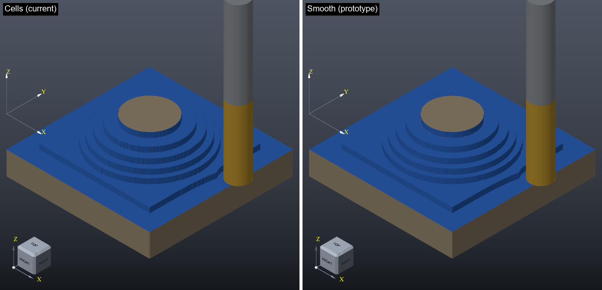
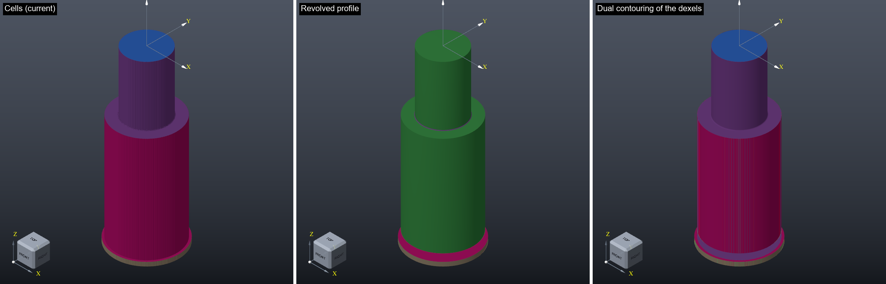

# DL-0040: Smooth stock display from the tri-dexel (dual contouring) and revolved lathe profiles

- **Status:** implemented (migration step 1: the GUI's default display; Preferences > General >
  Simulated stock switches back to cells). Steps 2 to 5 are proposed.
- **Module:** libs/sim (`Surface.hpp`: `contourStock`, `buildSurfaceMesh`, `CutColours`,
  `revolvedMesh`, `ProfileDistance`; `DisplayOptions::smooth`), libs/document
  (`simulatePartialLathe`, `latheDisplayMesh`, `SetupSimulation::partProfile`),
  apps/opencam-gui (`SimulationPanel`, the preference)
- **Patent gate:** proposed low (citation only), pending the review group. The methods used are
  older than 20 years (see "Patent notes"); several nearby approaches are flagged.
- **Author(s):** OxCAM contributors

## Problem

The simulated stock looks rough: terraces and moiré rings on the dome, stair-stepped curved
walls in pockets, vertical streaks on turned diameters. DL-0012 draws only the Z grid, as a
height field of merged cells (at most `maxCells` per side, the median ray top per cell) with
vertical walls between cells. That throws away information the simulation already has:

- the X and Y grids, which hold walls and undercuts at full resolution;
- the exact positions of the interval ends along every ray (the cells snap them to a terrace).

The question was whether a different stock representation is needed (signed distance fields,
B-rep or mesh Booleans, GPU methods), or whether a better display of the existing one is
enough. The display must still serve:

- part comparison (excess and gouge colours);
- per-operation colouring;
- incremental playback of 100k+ moves;
- the per-operation checkpoints.

Rest machining and collision checks read the dexels directly and must keep working.

## Findings

### The tri-dexel already holds the surface exactly

The three grids are built from the same bounds and spacing (`Stock::fromMesh`,
`Stock::fromRevolvedProfile`):

- Z rays pass through (x0 + (i + ½)h, y0 + (j + ½)h);
- X rays through (y0 + (j + ½)h, z0 + (k + ½)h);
- Y rays through (z0 + (k + ½)h, x0 + (i + ½)h).

So the rays are the edges of one cubic lattice, and every interval end is an exact crossing of
the stock's boundary with a lattice edge. These are along all three axes, from exact per-ray
sweeps. That is precisely the input of the feature-preserving iso-surface extractors:

- Extended Marching Cubes calls them "directed distances";
- Dual Contouring calls them Hermite data, crossing points plus normals.

Benouamer and Michelucci did this on a triple-ray representation in 1997, for a commercial NC
simulation. The cell look is a display choice, not a limit of the simulation.

### Candidates compared

| Family | Accuracy | Smooth / sharp | 100k-move playback | Memory | Comparison, rest, collisions | Verdict |
|---|---|---|---|---|---|---|
| Z height field (current) | Exact in Z; walls quantised to a cell | Terraces, stairs | Fast | Paid already | All work (Z only) | Replace the display |
| **Tri-dexel + dual contouring** (this entry) | Exact crossings; vertices from tangent planes | Smooth surfaces, sharp edges | Cell-local, chunked, incremental | No change to the stock | Unchanged; comparison colours can become 3D | **Adopt** |
| Tri-dexel + Marching Cubes / EMC / CMS | As DC (MC bevels edges) | MC bevels, EMC/CMS sharp | Cell-local | No change | Unchanged | Equivalent alternatives; CMS if manifold output is needed |
| Sparse narrow-band SDF (VDB) | Voxel-limited; edges rounded | Smooth, rounded | Fast CSG; meshing per frame | Several times the tri-dexel per µm | Good distance queries | A new representation for a worse surface |
| Composite ADF (MERL 2012) | Exact (sub-µm) | Exact by ray casting | Simulation fast; display ~1 s/frame then | Very low | Excellent | Patent-encumbered; large rewrite |
| B-rep Booleans (OCCT) | Exact | Exact | Hours for ~340k moves (Sullivan 2012) | Grows with moves | Exact comparison | Too slow for playback; final-stock export only |
| Mesh Booleans (Manifold, Cherchi 2022) | Exact or near | Exact facets | Cost and mesh grow per move; unproven at 100k | Grows | Good export | Not for playback |
| GPU image-space dexels | Pixel-limited | Smooth on screen | Very fast | Low | None (view-dependent) | Display-only; needs a GPU path in OCCT |
| Turning: revolve the exact 2D profile | Exact (chord tolerance) | Exact | Trivial (thousands of triangles) | Tiny | 2D comparison is exact | **Adopt for lathe setups** |

The sources below are the core of a wider literature survey (about 50 references) kept with
the exploration's notes.

## Approach

### Milling stock: dual contouring of the tri-dexel

`contourStock` works on the lattice of every `stride`-th ray. The stride is chosen so that at
most `maxCells` cubes lie along the stock's longest axis, matching the cell display's merge
factor. The lattice reaches one point past the grids on each axis; those points hold no
material, so the surface closes.

1. **Inside/outside at lattice points.** Taken from the Z rays: one bit per lattice point,
   packed 64 to a word per (i, j) column.
   - The Z grid is authoritative, as for volume and comparison. This settles the "three rays
     disagree at a vertex" problem Benouamer and Michelucci describe, without perturbing dexels.
   - Crossed edges are found by XOR of neighbouring columns (X and Y edges) or of a column with
     itself shifted by one (Z edges).
2. **Crossing on each crossed edge.** It is the interval end of the right kind (a top where
   material lies at the low end, else a bottom) nearest the edge's middle, on the ray that is
   that edge: the Z, X or Y ray through the edge. It is clamped to the edge. Without a matching
   end (the side grids disagree by a fraction of a cell, or the stock is Z-only), the edge
   midpoint is used, without a normal.
3. **Normal at each crossing.** Estimated from the matching ends on the four neighbouring
   parallel rays, one ray spacing away (within two spacings along the ray). These give the
   boundary's slopes along the two other axes, so n ∝ (1, −∂t/∂u, −∂t/∂v) in the ray's frame.
   - Where the two sides disagree (an edge lies between the rays), the gentler side is taken.
     A floor crossing next to a wall then gets the floor's normal, and the wall's own crossings
     get the wall's normal (an ENO-style choice).
   - No normal is used where a neighbour has no matching end.
   - No data is added to the stock.
4. **Vertex per cube** (the dual-contouring step). For each cube with crossed edges, the
   vertex is the point nearest the crossings' tangent planes: the quadratic error function
   Σ (nᵢ·(x − pᵢ))². It is solved about the crossings' mean with the eigenvalues below 0.1
   dropped, so flat and cylindrical cubes keep the mean along the free directions. The result is
   clamped to the cube, or replaced by the mean when it lands more than a quarter cube outside.
   This puts vertices exactly on the box edges and corners and on the pocket's floor-to-wall
   edges.
5. **One quad per crossed edge**, joining the four cubes around it. It is oriented by which end
   holds material and split along its shorter diagonal.
6. **Shading normals.** Each vertex takes the area-weighted normal of its faces within 0.6 rad
   (about 35°) of the face being drawn. Sharp edges stay sharp, curved surfaces shade smoothly.
   A vertex is repeated once per crease side.

The extraction is local, so the display is built in 32 × 32 lattice-point column chunks, each
one independently with a two-cube margin, in parallel. The pieces are seamless.

**Playback.** `StockDisplay` rebuilds only the chunks within three lattice cubes of a changed
Z tile. It also catches walls that move on the X and Y grids alone: the exact extent of each
changed side ray, from the symmetric difference of its old and new intervals. Copy-on-write
tiles find the changed tiles as before.

**Colours.** The cell grid is still computed, for the comparison values. Tops take their
cell's colour; walls and undersides follow `emitCells`' rules. With the stocks before each
operation (`starts`), `CutColours` colours every surface point by the operation that cut it:

- the crossing on the ray along the normal's main axis nearest the point is looked up in each
  earlier stock;
- the last operation whose starting stock lacks it made it.

This fixes the streaked walls that per-Z-ray cut marks give, with no change to the dexels.
Gouges and at-size cells keep their comparison colours.

### Turning stock: the exact profile revolved

`revolvedMesh` sweeps each edge of the axisymmetric stock's half profile (`LatheStock`, DL-0021)
about the spindle axis.

- **Segments:** N = ⌈π / acos(1 − t/r_max)⌉, with chord tolerance t = 5 µm.
- **Normals:** the profile edge's normal turned about the axis, smoothed across profile corners
  flatter than the crease angle.
- **Colours** (`document::latheDisplayMesh`). The profile is coloured in pieces of at most
  0.25 mm, each in the colour of its middle:
  - *Comparison:* the signed 2D distance from the piece to the part's half profile. Beyond the
    tolerance inside it is a gouge; within the tolerance it is at size. This is a true radial or
    normal deviation, not the axial excess of DL-0021's known limitation.
  - *Half profile* (`ProfileDistance::section`, once per simulation): the part mesh cut by a
    plane through the spindle axis (y = 10⁻⁶ mm, so seam vertices of revolved faces never lie on
    it), kept as segments for the distance and an even-odd inside test. This is exact up to the
    part's tessellation, bores included.
  - *Not `revolvedEnvelope`:* the chuck envelope takes each slice's smallest and largest surface
    radius. On a solid shaft that is a hollow tube with thin end caps, which is right for a
    body's swept space but wrong for comparison. The prototype's first version showed the
    shaft's front face as excess because of it.
  - *Otherwise:* by the operation whose starting profile does not pass through the point.

## Measurements

Run with `test_document "[smoothbench]"` (`tests/unit/document/SmoothStockBench.cpp`), msvc-release
(RelWithDebInfo), 24 hardware threads, 2026-10-28. Setup:

- The generated fixture projects are simulated at their automatic resolution.
- The display uses the GUI's settings (`maxCells` 800).
- **Accuracy:** the distance from the display mesh to the exact part (the part's tessellation at
  0.01 mm deflection). It is sampled at triangle centroids and edge midpoints, area-weighted, over
  the area within 0.5 mm of the part, i.e. the surfaces meant to be the part. "Near" is that
  area's share of the whole mesh.
- **Bias in the dome's numbers:** they include its real scallops and leftover stock, so only the
  difference between rows matters there.

| Fixture (rays) | Display | Triangles | MB | Build ms | Near | Mean mm | RMS mm | p95 mm | Max mm |
|---|---|---:|---:|---:|---:|---:|---:|---:|---:|
| Block: face, pocket, profile (1022 × 622 at 0.1) | cells (current) | 607,588 | 40.1 | 29 | 100 % | 0.0459 | 0.0675 | 0.1000 | 0.136 |
| | **dual contouring** | 1,140,000 | 29.9 | 49 | 100 % | **0.0001** | 0.0006 | 0.0000 | 0.013 |
| | dual contouring, every ray | 4,560,000 | 119.5 | 182 | 100 % | 0.0001 | 0.0006 | 0.0000 | 0.013 |
| Dome: rough, rest, parallel, waterline (822 × 822 at 0.1) | cells (current) | 1,174,022 | 77.5 | 45 | 97.4 % | 0.0402 | 0.0779 | 0.1185 | (0.5 cap) |
| | **dual contouring** | 997,768 | 26.2 | 38 | 97.6 % | **0.0170** | 0.0655 | 0.0833 | (0.5 cap) |
| | dual contouring, every ray | 3,994,180 | 104.8 | 142 | 97.6 % | 0.0170 | 0.0655 | 0.0858 | (0.5 cap) |
| Shaft, turned (642 × 642 at 0.05) | cells (current) | 1,352,944 | 89.3 | 63 | 81.6 % | 0.0114 | 0.0149 | 0.0280 | 0.132 |
| | dual contouring | 1,036,416 | 27.1 | 58 | 81.6 % | 0.0043 | 0.0060 | 0.0065 | 0.122 |
| | **revolved profile** | 5,544 | 0.2 | 0.4 | 81.6 % | **0.0023** | 0.0048 | 0.0062 | 0.119 |

What the table shows:

- **Block:** the smooth surface lies on the part to a tenth of a micron on average, with a 13 µm
  worst case (the pocket's corner fillets at the part tessellation's chord). The cells are off
  by up to a ray spacing, by construction.
- **Dome:** every ray gives the same numbers as every second ray. The remaining 0.017 mm is the
  dome's real scallops and steps, not the display.
- **Shaft:** the revolved profile is the most accurate, 200 times smaller than any 3D mesh, and
  builds in under a millisecond.
- **Shaft maximum:** it comes from the parted-off end within 0.5 mm of the part, the same in
  every row.

**Playback.** The longest milling operation is played in 60 frames. Both displays are updated
after each frame (incremental, as in the GUI). The 100k-move case is the simulation benchmark's
zigzag (DL-0012) with a 10 mm ball, 100 × 100 mm at 0.1 mm, played in 200 frames.

| Case | Simulate ms/frame | Cells update ms/frame (max) | Smooth update ms/frame (max) |
|---|---:|---:|---:|
| Block pocket, 137 moves | 6.2 | 1.5 (3.0) | 5.3 (8.6) |
| Dome rough, 3,938 moves | 18.6 | 13.6 (31.8) | 26.1 (47.4) |
| Zigzag, 100,001 moves | 42.9 | 13.4 (19.5) | 12.8 (16.4) |

- **Full build:** 1.91M triangles of cells in 83 ms; 1.36M triangles smooth in 53 ms.
- **Simulation is unchanged.** The 100k moves take 7.2 s with a ball, and the fixtures' times
  above are their usual ones; the representation is the same.
- **Scratch buffers matter.** Before per-thread scratch buffers, the smooth display took 2 to 3
  times longer: about 1 MB of index allocated per chunk.

**Screenshots.** These are GUI `--screenshot-sim` captures, cells on the left and the prototype
on the right, at the final stock and at playback positions:

- `docs/images/dl0040-dome-final.png`
- `docs/images/dl0040-dome-after-rough.png`
- `docs/images/dl0040-dome-mid-rough.png`: z-level roughing terraces. Cells show staircase
  walls on every terrace; the smooth walls are clean circles coloured by the roughing operation.
- `docs/images/dl0040-block-final.png`, `docs/images/dl0040-block-mid-pocket.png`: the filleted
  pocket corners.
- `docs/images/dl0040-shaft-final.png`: three panels (cells, revolved profile, dual contouring
  of the dexels). With cells the diameters read as excess, because comparison along the
  spindle axis counts the whole column. The revolved profile's 2D comparison shows them at size,
  with only the shoulder fillet the turning tool cannot reach.
- `docs/images/dl0040-shaft-after-rough.png`

## Sources

The survey these come from lists about 50 references. It is kept with the exploration's notes;
the ones this entry relies on are:

- M. O. Benouamer, D. Michelucci, *Bridging the gap between CSG and Brep via a triple ray
  representation*, Proc. 4th ACM Symposium on Solid Modeling and Applications, 1997, pp. 68–79.
  DOI 10.1145/267734.267755. Tri-dexel to Marching Cubes with exact ray hits; the three-ray
  consistency problem.
- L. P. Kobbelt, M. Botsch, U. Schwanecke, H.-P. Seidel, *Feature sensitive surface extraction
  from volume data* (Extended Marching Cubes), SIGGRAPH 2001, pp. 57–66.
  DOI 10.1145/383259.383265. Directed distances along x, y, z; tangent-plane feature vertices.
- T. Ju, F. Losasso, S. Schaefer, J. Warren, *Dual contouring of Hermite data*, ACM TOG 21(3)
  (SIGGRAPH 2002), pp. 339–346. DOI 10.1145/566654.566586. One vertex per cube from a QEF, a
  quad per sign-changing edge, truncated pseudo-inverse.
- W. E. Lorensen, H. E. Cline, *Marching cubes*, SIGGRAPH '87, Computer Graphics 21(4), pp.
  163–169. DOI 10.1145/37402.37422. Background; cube-local extraction.
- C.-C. Ho, F.-C. Wu, B.-Y. Chen, Y.-Y. Chuang, M. Ouhyoung, *Cubical marching squares*,
  Computer Graphics Forum 24(3), 2005. DOI 10.1111/j.1467-8659.2005.00879.x. The manifold
  alternative.
- S. Schaefer, T. Ju, J. Warren, *Manifold dual contouring*, IEEE TVCG 13(3), 2007.
  DOI 10.1109/TVCG.2007.1012. Thin walls (two sheets in one cube).
- C. C. L. Wang, Y.-S. Leung, Y. Chen, *Solid modeling of polyhedral objects by Layered
  Depth-Normal Images on the GPU*, Computer-Aided Design 42(6), 2010.
  DOI 10.1016/j.cad.2010.02.001. Tri-dexel with a normal per sample, contoured.
- S. Stifter, *Simulation of NC machining based on the dexel model: a critical analysis*, Int.
  J. Adv. Manuf. Technol. 10(3), 1995. DOI 10.1007/BF01179343. Why one ray direction
  stair-steps.
- A. Sullivan, H. Erdim, R. N. Perry, S. F. Frisken, *High accuracy NC milling simulation
  using composite adaptively sampled distance fields*, Computer-Aided Design 44(6), 2012.
  DOI 10.1016/j.cad.2012.02.002. Figures for distance-field and B-rep simulation (compared, not
  used).
- K. Museth, *VDB: high-resolution sparse volumes with dynamic topology*, ACM TOG 32(3), 2013.
  DOI 10.1145/2487228.2487235. Compared, not used.
- G. Cherchi, F. Pellacini, M. Attene, M. Livesu, *Interactive and robust mesh booleans*, ACM
  TOG 41(6), 2022. DOI 10.1145/3550454.3555460. Compared, not used.
- L. Piegl, W. Tiller, *The NURBS Book*, 2nd ed., Springer, 1997. ISBN 3-540-61545-8. Surfaces
  of revolution; the sagitta bound for the segment count.
- C. Ericson, *Real-Time Collision Detection*, Morgan Kaufmann, 2005. ISBN 1-55860-732-3.
  Closest point on a triangle (the accuracy measurement only).
- DL-0012 (dexel stock), DL-0021 (axisymmetric stock).

## Deviations from sources

- **Normals.** The normals are estimated from neighbouring rays' crossings rather than stored
  with the samples (LDNI) or taken from the field gradient (DC, EMC). Nothing is added to the
  stock. The one-sided choice at disagreements keeps sharp edges. Storing a normal or the
  cutting move per interval end would make them exact (see "Recommendation"); the prototype
  shows they are not needed for the look.
- **Inside/outside.** Taken from the Z rays alone, with crossings on X and Y edges clamped to
  their edge. Benouamer and Michelucci instead perturb the dexels until all three agree.
- **Display stride.** Every k-th ray is used, so the mesh size follows the cell display's. The
  crossings stay exact; detail narrower than k rays is lost, as with the cells' median.
- **Cut colours.** These come from looking up each crossing in the per-operation checkpoints,
  which the cited works do not have.

## Correctness and tests

- **Unit tests** (`tests/unit/sim/SurfaceTest.cpp`):
  - **Box stock:** a closed, consistently oriented mesh (every edge used once each way), the
    exact volume, every vertex on a face (corners exact), six normals only.
  - **Ball groove and revolved bar:** closed; every vertex within 0.2 h of the analytic
    surfaces (half cylinder and planes; cylinder and end faces), and the bar's volume within
    0.2 %.
  - **Revolved mesh of a tube:** closed; volume within 0.1 % of `revolvedVolume`.
  - **Incremental smooth `StockDisplay`:** after a cut, it equals a full rebuild (triangles and
    enclosed volume), and that volume is the stock's within 1 %.
  - **Axial section of a tube mesh:** signed distances in the wall, the bore, outside and past
    the end.
- **Document tests** (`tests/unit/document/SimulateTest.cpp`):
  - **Block fixture:** the smooth mesh shows the pocket floor at its depth and encloses the
    stock's volume within 0.5 %.
  - **Shaft on the lathe:** `simulatePartialLathe` mid-roughing matches `simulatePartial`. After
    the finish, the revolved display encloses the profile's volume within 0.1 %, is mostly at
    size (green), and has no gouge.
  - **Tube stock:** milled, every smooth vertex between the end faces lies on the bore or the
    outside diameter, within 0.2 of a ray spacing. Turned, the revolved display shows the bore
    and encloses the tube's volume.
- **GUI tests** (`--stock-display smooth|cells` fixes the display whatever the preference):
  - `gui.smoke_test_simulation_smooth_milled`: the block mid-pocket.
  - `gui.smoke_test_simulation_smooth_turned`: the shaft mid-roughing, with the insert.
  - `gui.smoke_test_simulation_cells`: the cell display.
- **Measurements** (`tests/unit/document/SmoothStockBench.cpp`): hidden, run with
  `test_document "[smoothbench]"`. They produce the numbers above.

## Recommendation

**Keep the tri-dexel as the stock. Replace its display with dual contouring of all three grids,
and show lathe stock as its revolved exact profile.**

- **Why not a new representation.** The rough look comes from the display. The tri-dexel already
  holds exact surface crossings on three axes. A distance field would round the edges the
  dexels keep, and would need a new removal kernel, new checkpoints and a new comparison. Exact
  B-rep or mesh Booleans are orders of magnitude too slow for 100k-move playback, and their
  cost grows with every move. ADF milling simulation is patent-encumbered.
- **Cost.** About 1,000 lines in libs/sim (`Surface.cpp` plus the display path in
  `Compare.cpp`). No new dependency and no GPU requirement. The stock, removal, checkpoints,
  comparison numbers, rest machining and collision checks are unchanged.
  - Full builds are as fast as the cells' or faster.
  - Playback updates cost between the same and about twice the cell display's, and stay below
    the simulation's own time per frame.
  - The mesh has about as many triangles as the cells, with shared vertices: a third of the
    memory.
- **Turning.** The exact profile is about 10,000 times smaller than any 3D mesh of it, exact,
  and gives a true radial comparison.

### Migration plan

Each step keeps comparison, rest machining, collisions, playback and checkpoints working,
because none of them reads the display.

1. **Smooth display by default. Done.**
   - The GUI draws the smooth surface unless Preferences > General > Simulated stock is set to
     Cells (setting `simulation/stockDisplay`).
   - `StockDisplay::update` gets the operations' starting stocks for the cut colours. The cell
     code stays for the preference and for callers that do not ask for smooth (the CLI,
     `buildDisplayMesh` by default).
   - Lathe setups draw `document::latheDisplayMesh`: the axisymmetric stock at the playback
     position (the frame's own axisymmetric stock, as playback keeps it; `simulatePartialLathe`
     gives it outside playback), revolved and compared with the part's half profile, cut once
     per simulation.
   - Tests: the SurfaceTest cases, the axial-section distances, the block fixture's smooth mesh
     (pocket floor and enclosed volume), the shaft's revolved display (enclosed volume, at size
     after the finish, no gouge), and the GUI simulation smoke test.
2. **3D comparison colours.** Colour each smooth vertex by its true distance to the part (closest
   point on the part mesh through `geom3d::TriangleBvh`; inside or outside from the part's Z
   rays). Lathe setups use the profile's 2D signed distance (`ProfileDistance`, done).
   - This removes DL-0012's "excess is measured along Z" and DL-0021's axial-excess
     limitations from what the user sees.
   - The reported volumes stay per ray, since volumes are exact that way.
3. **Fewer triangles on flat areas.** Simplify each chunk's flat regions: collapse vertices
   whose quadratic error stays below a tolerance (the octree simplification of Ju et al.
   2002), or merge coplanar quads. A machined block is mostly planes, and the 1.1M triangles
   of the block fixture would drop by one to two orders of magnitude. Only needed if large
   stocks strain the GPU.
4. **Optional, only if wanted later:** a tag per interval end (the operation or move that made
   it, 16 to 32 bits). Interval would grow from 8 to 12 bytes, so the stock takes 1.5 times the
   memory. That gives exact normals from the tool sweep, "which move cut (or gouged) here" on
   click, and colours without checkpoints. It is a change to `subtract` and all sweeps (DL-0012,
   DL-0026); this entry's display does not need it.
5. **Optional robustness:** where walls thinner than one display cube appear (finishing
   slivers), use Manifold Dual Contouring or Cubical Marching Squares (several vertices per
   cube). Do not adopt the 2024 multi-feature scheme without the review group (see "Patent
   notes").

Alan chose step 1, smooth by default with cells as a preference (2026-10-28). Open: whether
the display mesh's size (about the cells') is fine, or step 3 should come next for very large
stocks.

## Patent notes

CONTRIBUTING.md reserves patent searching to the review group, so none was done here. What the
prototype uses:

- **Dexel and tri-dexel simulation:** the IP policy lists it as low risk.
- **Iso-surface extraction:** dual contouring (2002), Extended Marching Cubes (2001), Marching
  Cubes (1987), and Benouamer and Michelucci's tri-dexel contouring (1997). All are more than 20
  years old.
- **Normals:** finite differences between neighbouring samples.
- **Surface of revolution:** textbook.

Ordinary literature searches surfaced some patent documents; none was opened or analysed. Their
numbers are in the exploration's notes for the review group, not here, following the IP
policy's review-group rule. The families:

- **MERL (Mitsubishi Electric):** adaptively sampled distance fields and composite-ADF milling
  simulation. **Not used.** Avoid per-cell references to swept-tool distance functions.
- **Iowa State University:** dexel milling simulation and verification, granted in the 1990s,
  so very likely expired. It concerns dexel verification, which DL-0012 already does.
- **Dassault Systèmes:** designing a modelled volume represented by dexels (updating dexels
  after a sculpting operation). This concerns DL-0012's existing removal, not this display. The
  review group should look at it for the dexel simulation as a whole.
- **ModuleWorks** co-authored Schleifstein et al. 2024 (several sharp features per tri-dexel
  cell). **Not used**; flag before adopting that scheme. EMC, CMS and Manifold DC are the older
  alternatives.
- **Marching Cubes** (General Electric) is long expired.
- **Libraries.** OpenVDB and Manifold are Apache-2.0, with contributor patent grants for using
  the libraries, not for reimplementations. Neither is used.

Suggested gate: low (citation only), with the Dassault family noted for the dexel simulation
generally.

## Known limitations

- **Thin features.** One vertex per cube: walls or slivers thinner than a display cube collapse
  or pinch (non-manifold), and features narrower than the stride are skipped, as the cells'
  median skips them. Manifold DC or CMS would fix the former (step 5).
- **Estimated normals** can tilt a vertex near a corner where three faces meet within one cube
  (one normal per crossing, from the gentler side). The box and pocket tests show exact corners;
  multi-feature cubes (crossing toolpaths) can still round by up to a cube.
- **Z-only stocks** (`triDexel = false`, coarse rest-machining previews) have no side crossings.
  Walls fall back to edge midpoints and come out bevelled, which is still better than cells.
- **Comparison colours** still come from the Z rays' cells (step 2). On walls, "at size" follows
  the cell next to the wall.
- **Lathe display.** It revolves the whole profile every frame, which is cheap: thousands of
  triangles in well under a millisecond, plus the turning replay `simulatePartial` already does.
  Milling operations in a lathe setup (mill-turn, phase 10) are not drawn on it yet.
- **Translations.** The new preference's texts are not in `translations/opencam_en.ts` yet. The
  base branch's file is already behind its sources, so the next `update_translations` run picks
  them up with the rest.
- **Triangle count** is not simplified (step 3).
